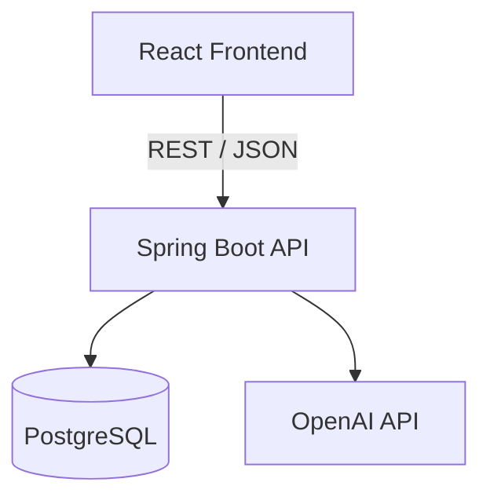

# Campus Fix AI

An AI-assisted campus IT support and ticketing system. Students and faculty report technology problems through a simple form; an AI triage step automatically classifies, prioritizes, and summarizes each issue; and IT technicians manage the resulting tickets and campus equipment through a dashboard.

Built as a portfolio project demonstrating a full-stack application with a real third-party AI integration, not a static demo.

## Problem being solved

Campus IT helpdesks typically rely on manual triage: a technician reads every submitted ticket, decides what category and priority it belongs to, and figures out next steps before work can begin. That's slow when volume is high and inconsistent across different technicians. Campus Fix AI automates the first pass of that triage — classifying the issue, assigning a priority, and suggesting an initial troubleshooting response — so technicians can focus on verifying and resolving rather than reading and guessing.

## Features

- **Issue reporting form** — students/faculty submit a problem with location, equipment type, and a free-text description.
- **AI ticket analysis** — the backend sends the description to the OpenAI API and receives back a structured category, subcategory, priority, summary, and suggested troubleshooting response. The AI output is validated on the backend before being trusted or stored; if the AI call fails, the ticket is still created and flagged for manual triage instead of being blocked.
- **IT dashboard** — filterable table of all tickets (by status, priority, category) with live counts of open, in-progress, resolved, and high-priority tickets, plus the most common issue category.
- **Ticket detail view** — technicians can view the full issue and AI analysis, assign a technician, change status, add resolution notes, and mark tickets resolved.
- **Equipment tracking** — a simple asset registry (asset ID, name/type, building, room, status) so IT can see which equipment is operational, has a reported issue, or is under repair.

## Architecture



- **React (Vite)** frontend — pages for reporting issues, the dashboard, ticket detail, and equipment tracking. Talks only to the Spring Boot REST API; it never calls OpenAI directly and never sees the API key.
- **Spring Boot** backend — REST controllers → services → repositories, following a standard layered architecture. `AIAnalysisService` is the only class that talks to OpenAI, and it runs entirely server-side.
- **PostgreSQL** — stores tickets and equipment.
- **OpenAI API** — called from the backend to classify and summarize each reported issue.

## Tech stack

| Layer | Technology |
|---|---|
| Frontend | React 18, React Router, Vite |
| Backend | Java 17, Spring Boot 3 (Web, Data JPA, Validation) |
| Database | PostgreSQL |
| AI | OpenAI Chat Completions API |
| Tooling | Maven, Git/GitHub, Postman |

## Project structure

```
campus-fix-ai/
├── campus-fix-api/          # Spring Boot backend
│   └── src/main/java/com/campusfix/api/
│       ├── controller/       # REST endpoints
│       ├── service/          # business logic + OpenAI integration
│       ├── repository/       # Spring Data JPA repositories
│       ├── model/            # JPA entities + enums
│       ├── dto/               # request/response objects
│       ├── config/           # CORS, RestTemplate/OpenAI config
│       └── exception/        # centralized error handling
├── campus-fix-web/          # React frontend
│   └── src/
│       ├── pages/             # route-level pages
│       ├── components/        # reusable UI components
│       ├── services/          # API client modules
│       └── hooks/             # data-fetching hooks
└── README.md
```

## Database schema

**tickets** — requester info, location, equipment type, original description, AI-generated fields (category, subcategory, priority, summary, suggested response — all nullable since the AI call can fail), assigned technician, status, resolution notes, timestamps.

**equipment** — asset ID (unique), name, type, building, room, status, timestamps.

Schema is defined explicitly in [`campus-fix-api/src/main/resources/db/migration/V1__init.sql`](campus-fix-api/src/main/resources/db/migration/V1__init.sql) rather than relying on Hibernate auto-DDL, so the schema is reviewable and reproducible.

## API endpoints

**Tickets**
| Method | Endpoint | Description |
|---|---|---|
| POST | `/api/tickets` | Create a ticket; triggers AI analysis synchronously |
| GET | `/api/tickets` | List tickets (`?status=&priority=&category=`) |
| GET | `/api/tickets/{id}` | Get one ticket |
| GET | `/api/tickets/stats` | Dashboard counts + most common category |
| PATCH | `/api/tickets/{id}/status` | Update ticket status |
| PATCH | `/api/tickets/{id}/assign` | Assign a technician |
| PATCH | `/api/tickets/{id}/resolve` | Add resolution notes and mark resolved |

**Equipment**
| Method | Endpoint | Description |
|---|---|---|
| GET | `/api/equipment` | List all equipment |
| POST | `/api/equipment` | Register a new asset |
| PATCH | `/api/equipment/{id}/status` | Update asset status |

## Setup instructions

### Prerequisites
- Java 17+
- Maven (or use the included wrapper if you generate one via `mvn -N wrapper:wrapper`)
- Node.js 18+
- PostgreSQL 14+
- An OpenAI API key ([platform.openai.com/api-keys](https://platform.openai.com/api-keys))

### 1. Database
```bash
createdb campus_fix_ai
psql -U postgres -d campus_fix_ai -f campus-fix-api/src/main/resources/db/migration/V1__init.sql
```

### 2. Backend
```bash
cd campus-fix-api
cp .env.example .env   # then fill in real values
# export the variables in .env into your shell, or configure them in your IDE run config
export $(grep -v '^#' .env | xargs)
mvn spring-boot:run
```
Backend runs on `http://localhost:8080`.


## Future improvements

- Authentication/authorization for technicians (currently technician assignment is free-text, with no login)
- Ticket comment/activity history beyond a single resolution-notes field
- File/screenshot attachments on ticket submission
- Pagination and server-side sorting for large ticket volumes
- Email notifications on status changes
- Automated test suite (unit tests for services, integration tests for controllers)

## License

MIT
